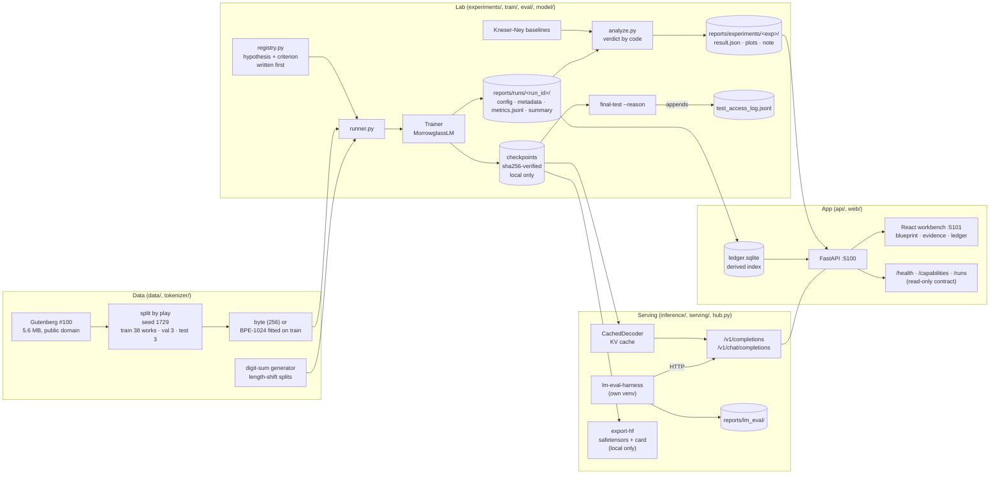
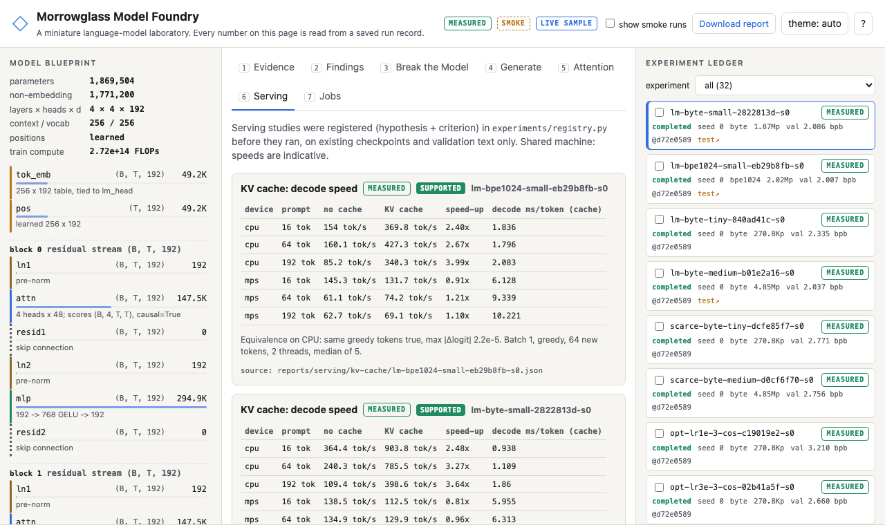
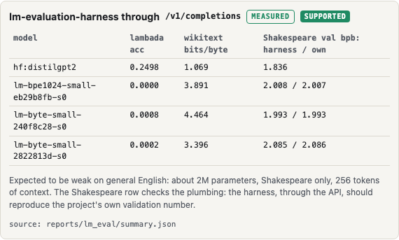
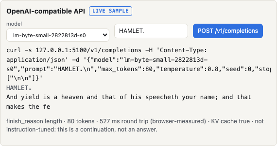

# Morrowglass Model Foundry

[](https://github.com/AlexRosen23/morrowglass-model-foundry/actions/workflows/ci.yml)

Morrowglass is a small language-model laboratory that runs on a laptop. It has:

- a decoder-only Transformer written in plain PyTorch;
- a data pipeline that splits public-domain Shakespeare by play;
- strong count-based baselines;
- a pre-registered set of experiments;
- a serving layer: a KV cache, OpenAI-compatible `/v1` endpoints, the EleutherAI lm-evaluation-harness run through those endpoints, and a Hugging Face Hub-compatible export.

Every number it reports, in the docs and in the browser workbench, is read from a saved record that names its commit, seed, data hash and hardware.

It is for engineers who want to see how a small model behaves when data and compute are tiny, and how to measure and serve it without fooling themselves. You can:

- reproduce the experiments from the command line;
- browse the 32 recorded runs and 12 experiment verdicts in the workbench;
- sample from a checkpoint next to an n-gram baseline;
- inspect attention heads;
- watch the model being broken on purpose and then fixed;
- call a trained checkpoint with any OpenAI client.

## At a glance

| | |
|---|---|
| **Status** | Working. All 12 research experiments and all 3 serving/eval studies have run and are analysed. Nothing is deployed: everything runs on 127.0.0.1. |
| **Stack** | Python 3.12, PyTorch 2.15 (MPS or CPU), HF `tokenizers`, FastAPI, SQLite (a derived index only), safetensors, lm-eval 0.4.13 (separate venv), Vite + React + TypeScript, `uv`, `pytest`, `ruff`, `mypy` |
| **Run it** | `make setup && make smoke && make demo`, then open http://127.0.0.1:5101 |
| **Verified** | 2026-11-09, against `main` at `2758c42`. A fresh clone passed `make setup` and `make ci` (114/114 tests). `make demo` was started and checked in a browser, and `/v1/completions` was called on a real checkpoint. A second, skeptical-reviewer audit of a fresh clone the same day led to fixes [#5](https://github.com/AlexRosen23/morrowglass-model-foundry/pull/5), [#6](https://github.com/AlexRosen23/morrowglass-model-foundry/pull/6) and [#7](https://github.com/AlexRosen23/morrowglass-model-foundry/pull/7); this README describes the project with them merged. |
| **Hardware the evidence came from** | Apple M5 Pro (18 cores, 48 GB), PyTorch MPS; 4 CPU threads for training, 2 for the serving studies; a machine shared with other workloads |
| **Reviewing for AI engineering?** | Start with [serving and standard evals](#serving-and-standard-evals), then [docs/AI_ENGINEER_READINESS.md](docs/AI_ENGINEER_READINESS.md) |

## Why this exists

### The question

> On a fixed public-domain corpus and a laptop-scale budget, how much does a small Transformer written from scratch improve on a strong count-based language model for held-out text? And which choices (tokenization, capacity, optimisation) move that number by more than run-to-run noise?

([docs/RESEARCH_QUESTION.md](docs/RESEARCH_QUESTION.md))

Most of the author's other projects call hosted models through an API. This one opens the box. It writes the network, the training loop, the tokenizers and the evaluation by hand, then asks whether the result is actually better than a model built from counting.

A second, practical question followed: does a model built this way hold up behind the interfaces that production models use? That means an OpenAI-compatible API, a standard eval harness, a Hub-format artifact, and the usual latency tricks.

### Why the obvious approach falls short

The obvious version of this project is "train nanoGPT on Shakespeare, show a falling loss curve and some generated text". At this scale every part of that picture can mislead:

- **Perplexity isn't comparable across tokenizers.** A BPE model and a byte model report perplexity over different units, so the lower number isn't necessarily the better model.
- **Random-chunk splits leak.** The same characters, refrains and repeated lines end up on both sides of the split, so "held-out" text is partly memorised.
- **A weak baseline flatters the network.** Beating a unigram model says nothing. The fair opponent is a well-smoothed n-gram, with its order tuned on validation.
- **Small differences are noise.** At about 2 bits/byte, gaps of 0.02 are within run-to-run variation. A single number per run can't show that.
- **Looking at the test set repeatedly turns it into a training signal.** After a few "quick checks", the test score is a selection result, not an estimate.
- **Goalposts move.** If the success criterion is chosen after the results are in, every experiment "works".
- **A dashboard can show things that never happened.** Hard-coded or smoothed charts make a demo look better than the runs behind it.
- **Serving optimisations can quietly change the model.** A KV cache or int8 weights that "feel faster" may return different tokens, or may not be faster at all on the hardware in hand.

### Design principles that follow

Each of these is visible in the code, not just the docs:

1. **One unit for every model: bits per UTF-8 byte (bpb).** Byte, BPE, n-gram and pretrained models are all scored in it, with a 95% bootstrap interval over evaluation windows (`eval/metrics.py`).
2. **Split by whole work.** Three validation plays and three test plays are chosen by seed 1729; the poems always stay in train. Line overlap is measured and recorded: 3 of 7,696 validation lines and 1 of 6,651 test lines also appear in train (`data/corpus.py`, `data/manifests/shakespeare.json`).
3. **A strong baseline.** Interpolated Kneser-Ney n-grams (byte orders 2-7, BPE orders 2-4), fitted on train and chosen on validation (`eval/ngram.py`).
4. **Pre-register, then run.** Each experiment's hypothesis and pass/fail criterion are written in `experiments/registry.py` before it runs, and the serving studies are registered in `EVALUATIONS` there. The verdict is computed by code. Follow-ups written after a result are labelled as such.
5. **A locked test split.** Training, model selection and the serving studies can't read it (`train/tasks.py`). The only way in is `morrowglass final-test --reason …`, and each opening is appended to `reports/test_access_log.jsonl`.
6. **Negative results stay.** Five registered hypotheses failed (four research, one serving). They're reported with the same prominence as the successes ([docs/FAILURE_ANALYSIS.md](docs/FAILURE_ANALYSIS.md), [docs/SERVING_RESULTS.md](docs/SERVING_RESULTS.md)).
7. **The UI can only show records.** The workbench reads JSON written by the CLI, and badges mark each item `MEASURED`, `SMOKE` or `LIVE SAMPLE`. Its charts are hand-written SVG with no smoothing.
8. **Optimisations must prove equivalence before they claim speed.**
   - The KV cache has to reproduce the uncached logits and greedy tokens.
   - The harness has to reproduce the in-house bpb on the same split before its other numbers are trusted.
   - The Hub export has to round-trip to identical logits.
9. **Integrity on unreliable hardware.** The development Mac has a known memory fault, so checkpoints are written with fsync and a read-back sha256 check. They load with `weights_only=True`, and a one-bit corruption is rejected (tested).

### What building it answers

- **Does a ~2M-parameter hand-written Transformer beat a 4-gram on 4.5 MB of text?** Not at the planned budget; yes at 4x the steps.
- **Does it hold up behind production interfaces?** Yes:
  - the KV cache gives a 2.4-4.0x CPU decode speed-up with identical tokens;
  - the harness agrees with the in-house evaluator to 0.0012 bpb;
  - the Hub export round-trips exactly.
  - Dynamic int8 made it *slower*.
- **What does an honest measurement pipeline for these questions need?** Building that pipeline was the larger part of the work.

## What works today

| Capability | Status | How it was verified |
|---|---|---|
| Decoder-only Transformer in native PyTorch (learned, sinusoidal or no positions; tied embeddings; explicit and fused attention paths) | Working | `tests/test_model.py`: future tokens never change earlier logits, and a mask-less model fails that check; analytic param count = actual; fused path = explicit path |
| Byte and byte-level BPE-1024 tokenizers (BPE fitted on train only) | Working | `tests/test_tokenizers_and_metrics.py`: lossless round trips |
| Shakespeare pipeline (Gutenberg #100, split by play, hashed manifest) | Working | `tests/test_data.py` (splits disjoint by work); `data/manifests/shakespeare.json` |
| Uniform, unigram and interpolated Kneser-Ney baselines | Working | KN distributions sum to 1 (test); `reports/baselines-shakespeare.json` |
| Trainer: AdamW, warmup + cosine, accumulation, clipping, early stopping, non-finite handling, STOP-file cancel, time budget | Working | `tests/test_trainer.py` (divergence detected without crashing, early stop, cancellation) |
| Verified checkpoints and resume | Working | Save → load gives identical logits; corruption is rejected; resume is bit-identical on CPU (tests). MPS runs are *not* bit-reproducible. |
| Pre-registered experiment registry → runner → analysis → report | Working | 32 runs in `reports/runs/`, 12 verdicts in `reports/experiments/*/result.json` |
| Re-training a committed run without touching its record (`morrowglass reproduce`) | Working | `tests/test_evidence_integrity.py` (the committed directory stays byte-identical). On a fresh clone `make reproduce-scratch` re-trained the flagship to 2.0840 bpb against the committed 2.0858 (inside its interval) in 7 min 42 s, and installed the weights labelled as re-trained. `run --force` refuses to overwrite a committed record. |
| Paired comparison against the best n-gram on the same bytes | Working (post-hoc, validation only) | `reports/paired/summary.json`, [docs/PAIRED_RESULTS.md](docs/PAIRED_RESULTS.md); `tests/test_paired.py` (per-token bits reproduce both evaluators; byte blocks line up across tokenizers) |
| Locked test split with an access log | Working | `train/tasks.py` (`final_eval` excludes test); 3 logged openings in `reports/test_access_log.jsonl` |
| Calibration (top-1 ECE, reliability diagram) and latency benchmark | Working | ECE behaves on known cases (test); `reports/runs/lm-byte-small-2822813d-s0/bench.json` |
| Digit-sum algorithmic track (length-shift splits, scratchpad variant) | Working | Expressions never cross splits (test); a copy-rule control proves the task pipeline can learn (`tests/test_synthetic_learning.py`) |
| distilgpt2 + LoRA vs frozen | Working, one seed, validation only | `reports/lora/distilgpt2-s0.json`. Ran once with the author's approval (about 350 MB download). CI tests the plumbing on a locally built random GPT-2, so it never downloads. |
| KV cache for decoding | Working | `tests/test_kv_cache.py` (cached = uncached logits); registered study `reports/serving/kv-cache/*.json` on real checkpoints |
| OpenAI-compatible `/v1/completions` (echo, logprobs, stop, seed, top-p/top-k, SSE) and `/v1/chat/completions` | Working, loopback only | `tests/test_openai_api.py`: echo logprobs = direct forward; stream = non-stream; seed determinism; non-loopback hosts refused. Called by hand on 2026-11-09. |
| EleutherAI lm-evaluation-harness through `/v1/completions` | Working (about 2.5 h for all models) | `reports/lm_eval/summary.json`, `run_meta.json` per model; pinned in `eval/lm-eval-requirements.txt` |
| Hugging Face Hub-compatible export (safetensors + config + model card) | Working, local only | `tests/test_hub_export.py` (identical logits, no network); `reports/hf_export/*/morrowglass.json`. **Nothing has been published to the Hub.** |
| Dynamic int8 quantisation study | Working (the hypothesis failed) | `tests/test_quant.py`; `reports/serving/int8/*.json` |
| FastAPI backend: run browser, generation, attention maps, bounded smoke job with SSE progress and cancel | Working, local only (127.0.0.1) | `tests/test_api.py`: responses equal the files on disk; path traversal → 404 |
| Read-only contract for other local apps (`/health`, `/capabilities`, `/runs`, `/runs/{id}`) | Working | `tests/test_api.py`; read by the author's (private) Constellation dashboard |
| Workbench UI: blueprint, evidence, ledger; Evidence, Findings, Break the Model, Generate, Attention, Serving and Jobs tabs | Working | `npm run build` (typecheck + build) in CI; checked in a browser on 2026-11-09; a Playwright walkthrough recording is at [docs/media/walkthrough.webm](docs/media/walkthrough.webm) |
| Portable model-artifact manifest | Working | Exports validate against `contracts/model_artifact_v1.schema.json` (test) |
| Extended profile (longer runs) | Partial | Run once, for the flagship only, with the author's approval. Other experiments were not re-run at that budget. |
| Multi-seed main track | Partial | One seed per main-track arm; three seeds only in the optimisation study |
| Production serving: batching, auth, rate limits, tracing, container, deployment | Not built | On purpose: single process, batch 1, loopback only |
| CUDA, multi-GPU | Not built | On purpose: the target is Apple silicon |
| Weights and processed data in git | Not built (by design) | Checkpoints, Hub folders and processed text are rebuilt locally; only hashes and model cards are committed |

Nothing here is simulated. The language-model runs trained on real text, and the digit-sum data is synthetic by design (generated from a seed). The demo serves recorded runs. Live generation and `/v1` need a local checkpoint, and smoke outputs are labelled `SMOKE` and never count as evidence.

## Quick start

**Requirements**

- macOS on Apple silicon, or any CPU machine (Linux CI uses CPU-only torch wheels);
- [`uv`](https://docs.astral.sh/uv/) 0.12+, which installs Python 3.12;
- Node 24+;
- free ports 5100 and 5101.

No API keys, no paid services. Setup needs network access for the packages only.

```bash
make setup     # uv sync --frozen (torch 2.15.0 etc.) + npm ci in web/
make smoke     # ~1 min on CPU, offline: sanity check, sample baselines, 3 tiny experiments
make demo      # builds the UI, then API on 127.0.0.1:5100 and workbench on 127.0.0.1:5101
```

**Expected result**

- `make smoke` ends with `smoke OK: outputs in reports/smoke/ (not evidence; plumbing only)`.
- `make demo` serves http://127.0.0.1:5101. It opens on the Evidence tab with the flagship run `lm-byte-small-2822813d-s0` selected, and the ledger lists the 32 measured runs (tick "show smoke runs" to include the smoke ones).
- `curl -s 127.0.0.1:5100/health` returns `{"ok": true, … "project_id": "morrowglass", "mode": "recorded", "runs": 32, …}`.

These were run from a fresh clone of `2758c42` on 2026-11-09, and `make ci` passed.

**Notes**

- `demo.sh` refuses to start if a port is busy. Set `API_PORT` and `WEB_PORT` to run a second copy; the workbench's proxy follows `API_PORT`.
- Checkpoints aren't in git. On a fresh clone the ledger, curves, findings and Serving tables all work. Generate, Attention and `/v1` need a local checkpoint:
  - `make reproduce-scratch` (about 5-8 min) downloads the corpus, re-trains the flagship from its committed config into `reports/reproduce/`, compares it with the record and, if it reproduces, installs the weights. The workbench and `/v1` label them as re-trained, not the original checkpoint.
  - Without it, those tabs fall back to a smoke checkpoint and say so. Its output is plumbing, not evidence.
  - `make standard` does not help here: it skips every run whose record is already committed.

### Calling a checkpoint like an OpenAI model

```bash
make serve-openai          # API + /v1 on 127.0.0.1:5100, default model lm-byte-small-2822813d-s0 (needs its local checkpoint)
curl -s 127.0.0.1:5100/v1/completions -H 'Content-Type: application/json' \
  -d '{"prompt":"HAMLET.\n","max_tokens":60,"seed":0}'
```

- Any OpenAI client works with `base_url="http://127.0.0.1:5100/v1"` and any API key.
- `/v1/chat/completions` exists, but every response says the model is not instruction-tuned.
- The server refuses to bind to a non-loopback host.
- The full guide is [docs/SERVING.md](docs/SERVING.md).

### Reproduce the evidence

The research runs take about 45-60 minutes on Apple silicon, and the commands are idempotent.

```bash
make data                                  # downloads Gutenberg #100 once (5.6 MB), builds splits + manifest
uv run morrowglass estimate capacity       # prints time / memory / disk before you commit to a run
make standard                              # every standard-profile experiment
make report                                # verdicts, plots, docs/RESULTS.md, HTML report, resume_evidence/metrics.json
```

The serving and eval studies need the flagship and BPE checkpoints:

```bash
make bench-kv              # KV-cache equivalence + decode speed → reports/serving/kv-cache/
make quant-int8            # dynamic int8 vs fp32 on CPU → reports/serving/int8/
make lm-eval-setup         # pinned lm-eval in .venv-lmeval (separate from the project lock file)
make lm-eval               # harness through /v1/completions on 127.0.0.1:5102 (~2.5 h on a busy M5 Pro)
make export-hf             # Hub-compatible folders in artifacts/hf_export/ (local only)
make serving-report        # regenerates docs/SERVING_RESULTS.md
make paired                # paired block bootstrap vs the best n-gram (CPU, ~3 min) → reports/paired/, docs/PAIRED_RESULTS.md
make reproduce-scratch     # re-train the flagship into reports/reproduce/ and compare with the committed record
```

Single steps:

```bash
uv run morrowglass sanity                              # overfit-one-batch check
uv run morrowglass baselines
uv run morrowglass run scratch --profile standard     # skips runs whose record exists; --force refuses to overwrite one
uv run morrowglass reproduce <run_id>                 # re-train a committed run elsewhere and compare
uv run morrowglass final-test --runs <run_id> --reason "<why>"   # opens the locked test split, and logs it
uv run morrowglass bench <run_id>
uv run morrowglass export-artifact <run_id>
```

The `extended` profile and the LoRA track (`uv run morrowglass lora --approved`) refuse to run without `--approved`. Run without it, they print their cost first.

## How it works



### One run, end to end: the flagship `lm-byte-small-2822813d-s0`

1. **Registered first.** The `scratch` experiment in [`experiments/registry.py`](src/morrowglass/experiments/registry.py) states the hypothesis ("a 1.9M-parameter byte-level Transformer … reaches lower held-out bits-per-byte than the best interpolated Kneser-Ney n-gram") and the criterion: the Transformer's upper 95% CI must be below the n-gram's lower 95% CI.
2. **Data.** [`data/corpus.py`](src/morrowglass/data/corpus.py) strips the Gutenberg boilerplate, splits by work and writes a manifest with sha256s. [`data/loader.py`](src/morrowglass/data/loader.py) caches token ids and samples batches.
3. **Model.** [`model/transformer.py`](src/morrowglass/model/transformer.py) builds `MorrowglassLM`, a pre-LayerNorm GPT-style decoder: 4 layers, 4 heads, d_model 192, context 256, byte vocabulary, 1,869,504 parameters. The architecture doc has a [shape-by-shape walkthrough](docs/ARCHITECTURE.md#the-model-line-by-line).
4. **Training.** [`train/trainer.py`](src/morrowglass/train/trainer.py) runs AdamW (lr 3e-3, β = 0.9/0.95, weight decay 0.1) with 100 warmup steps and a cosine decay, clipping at 1.0. It ran 2,500 steps × 32 × 256 = 20.48M tokens and evaluated every 100 steps. The run id is name + config hash + seed, so the same config always maps to the same id.
5. **Records.** `metadata.json` holds the commit, command, seed, dataset and tokenizer hashes, and hardware. `metrics.jsonl` holds every logged step. `summary.json` holds the best step, wall time (291 s) and final evaluation on the best checkpoint. Checkpoints go to `artifacts/` with a `.sha256.json` beside them.
6. **Verdict.** [`experiments/analyze.py`](src/morrowglass/experiments/analyze.py) compares the run with the val-chosen baseline (KN-4 on BPE tokens) and writes `reports/experiments/scratch/result.json`: **not supported**, 2.086 [2.074, 2.098] vs 2.107 [2.095, 2.120]. The intervals overlap. A later, explicitly post-hoc **paired** test on the same bytes separates them (below); the pre-registered verdict stays.
   - **Paired re-analysis (post-hoc).** Both models were scored on the same validation bytes, so their errors are correlated. [`eval/paired.py`](src/morrowglass/eval/paired.py) maps every token's bits onto contiguous 8 KiB byte blocks, the same for both tokenizers, and bootstraps the difference with the same resampled blocks. Flagship minus KN-4: **−0.021 bpb, paired 95% interval [−0.031, −0.011]**, lower in 40 of 52 blocks and in all three plays. On those same blocks the unpaired intervals overlap ([2.061, 2.112] vs [2.083, 2.132]).
7. **Test, once.** After all selection was finished, `final-test` opened the test split for this run and the other finalists. The opening was logged with its reason.
8. **Served.** The API rebuilds `artifacts/ledger.sqlite` from the JSON and serves it, and the workbench draws the curves from `metrics.jsonl`. The same checkpoint is loaded, after hash verification, by:
   - `/api/generate`, which shows each token's probability with a note that it is not calibrated confidence;
   - `/v1/completions` ([`serving/openai_api.py`](src/morrowglass/serving/openai_api.py)), which decodes through the `CachedDecoder` in [`inference/generate.py`](src/morrowglass/inference/generate.py).

   The harness then scored the flagship through that endpoint on the same validation split and got 2.0847 bpb, against the trainer's 2.0858.

## How it was built

### Phases and milestones

All work was on feature branches, merged with merge commits rather than squashed. Run records name the commit they started from, and squashing would have orphaned those commits.

| Phase | What landed | Where |
|---|---|---|
| A: foundation | Repo created with gitleaks hooks; model, tokenizers, data pipeline, trainer, n-gram baselines; split manifest with hashes | `f803baa`, `d72e058` (in [PR #1](https://github.com/AlexRosen23/morrowglass-model-foundry/pull/1)) |
| B: experiments + app | Registry, runner, analysis, FastAPI, React workbench, the test suite, and all standard-profile runs | `85bc7e9` |
| C: follow-ups | Digit-sum scratchpad and break-mask-long, both registered after their parent experiments failed and labelled as post hoc | `13867f1` |
| D: research write-up | Results, model and dataset cards, protocol, ablations, failure analysis, resume evidence, generated report | `a4c4444` |
| E: approved extras | LoRA with full-validation bpb and CIs (`39112b3`, `070d575`); GitHub Actions on (`490b8a8`); extended flagship run, 10k steps (`eca255f`) | PR #1, merged 2026-11-09 |
| Integration | Read-only `/health`, `/capabilities`, `/runs` contract; `demo.sh` works from a launcher's minimal PATH | [PR #2](https://github.com/AlexRosen23/morrowglass-model-foundry/pull/2), merged 2026-11-09 |
| F: serving and standard evals | Three studies pre-registered before any measurement (`d7e6512`); KV cache (`cf1c16d`); `/v1` endpoints (`bd81a4b`); harness runner, Hub export, int8, Serving tab (`be188a3`); generated serving report (`3987474`); results (`0594894`); Hub-name fix (`9fca106`) | [PR #3](https://github.com/AlexRosen23/morrowglass-model-foundry/pull/3), merged 2026-11-09 |
| Attach | The author's private Constellation dashboard opens this app and reads its runs | merged 2026-11-09 (private repo) |
| G: skeptical-reviewer audit | Fresh-clone audit of every tab and claim. Fixes: evidence-integrity and fresh-clone API ([#5](https://github.com/AlexRosen23/morrowglass-model-foundry/pull/5)); workbench honesty and crash fixes ([#6](https://github.com/AlexRosen23/morrowglass-model-foundry/pull/6)); a paired re-analysis, registered in its own commit (`3434773`) before measuring ([#7](https://github.com/AlexRosen23/morrowglass-model-foundry/pull/7)) | 2026-11-09 |

The repository was made public on 2026-11-09, after PR #3.

### Key decisions and trade-offs

The full table, with rejected alternatives, is in [docs/ENGINEERING_DECISIONS.md](docs/ENGINEERING_DECISIONS.md). The ones that shaped the project most:

- **Native PyTorch, not `AutoModelForCausalLM` or a nanoGPT copy.** The point is to own the internals. Training uses the fused SDPA kernel for speed, and a test proves it matches the explicit attention maths that the UI visualises.
- **JSON/JSONL records in git plus a derived SQLite index, not MLflow or W&B.** There are no services to run. Records are diffable and reviewable in a PR, and the index can always be rebuilt.
- **Learned absolute positions by default.** RoPE was the more modern choice. Learned positions were kept because they make the length-generalisation failure in the digit-sum track visible. The cost showed up later: the KV cache can't slide past 256 tokens and falls back to exact recomputation.
- **The API never trains from a request handler.** Only a bounded smoke job runs, in a subprocess with SSE progress and cancel. Real runs are CLI-only, so a browser can't start a long GPU job on a shared machine.
- **The harness evaluates the model through the API, not in-process.** That tests the serving path itself. Running it on our own validation split first gives a plumbing check with a known answer.
- **The harness gets its own venv.** lm-eval and its dependencies live in `.venv-lmeval`, pinned in `eval/lm-eval-requirements.txt`, so they never change the project's lock file.
- **Approval gates in code.** `--profile extended` and `lora` refuse to run without `--approved` and print their time, memory and disk cost first. `export-hf` only writes locally and prints the publish command for a human.

### Problems hit, and how they were solved

- **The plain digit-sum task never left chance.** Loss sat at ln 10 for every arm. Before blaming the model, a control test (`test_sumtask_pipeline_learns_a_copy_rule`) proved the same encoding, trainer and evaluator can learn a simple rule. A scratchpad variant (running sums, `3,3;9,2;…`) was then registered as an explicitly post-hoc follow-up. It reached 100% in distribution, and its OOD results exposed the learned-position limit.
- **Removing the causal mask didn't collapse training in 400 steps.** The registered prediction failed, and it stays as "not supported". A 2,000-step follow-up showed the shortcut clearly: the leaky model's training loss fell to 0.010 while its leak-free bpb was 3.38, against 2.57 for the causal model.
- **lr = 0.1 stalled instead of diverging.** The non-finite guard never fired. The result was recorded as observed (best val 4.08 bpb) rather than tuned until it "diverged properly".
- **MPS has no float64.** Evaluation now accumulates on the CPU in float64. MPS runs are documented as not bit-reproducible, while CPU resume is.
- **Position augmentation indexed out of bounds.** Offsetting positions past the context crashed. The fix rolls each example within its block instead (`train/tasks.py`).
- **Dependency conflict.** `transformers` 5.x needs `tokenizers` ≥ 0.23, which clashed with the pinned tokenizer, so the optional HF group is pinned to `transformers==4.57.6`.
- **Generation hung behind the n-gram fit.** Fitting the baseline for side-by-side samples blocked the request. Baseline generation moved to its own endpoint (`/api/baseline-generate`) with a background warm-up.
- **Shared-machine load.** The load average reached 77 during the standard batch, so wall times include contention. The medium model's 675 s compares with an estimated 8 min unloaded. Throughput is logged per step so slowdowns are visible.
- **A gitleaks false positive.** `tokenizer_sha256` matched the generic API-key rule. It's allowed only for exact 64-hex digests under `*_sha256` keys (`.gitleaks.toml`).
- **A dirty-tree LoRA run.** The LoRA run recorded `dirty=true` because analysis files were being edited while it ran. The run note discloses this and confirms that `finetune/lora.py` was identical to `39112b3`.
- **Launching from another app.** The dashboard's launcher starts processes with a minimal PATH, so `uv` and `node` weren't found. `scripts/demo.sh` now adds the user-local tool paths (PR #2).
- **The KV cache gave no gain on MPS.** At 2M parameters, kernel-launch overhead dominates. The study reports MPS without a criterion, and the speed-up claim is CPU-only.
- **int8 made decoding slower.** The registered hypothesis (int8 is faster with < 0.01 bpb loss) failed: 0.77x and 0.54x. It is kept as a negative result.
- **Two runs collided on one Hub repo name.** The standard and extended flagships produced the same name. Names now include the config hash and seed (`9fca106`).
- **"Reproduce" would have overwritten the evidence.** The audit found that `make reproduce-scratch` claimed to keep the original, but the run id is a hash of the config. So `run --force` would have re-trained into the committed run's own directory and left its locked-test result attached to new weights. `morrowglass reproduce` now re-trains into `reports/reproduce/` and compares; `--force` refuses to replace a committed record (#5).
- **The demo quietly showed the wrong model.** On a fresh clone (no weights in git), Generate, Attention and the `/v1` card swapped the selected flagship for a smoke checkpoint producing gibberish, labelled only "LIVE SAMPLE". The panels now say which checkpoint they show and why (#6).
- **A leaky number looked like the best score in the ledger.** The no-causal-mask run reads "val 0.013 bpb", which is the leaky windowed metric. It is now marked `leaky` (#5, #6).
- **Switching models blanked the app.** With layer 3 head 3 selected on a 4-head model, picking a 2-head model indexed past the attention array and unmounted the whole page. The layer and head are now clamped, and every tab sits in an error boundary (#6).
- **Small but real.** ⌘C (copy) cleared the curve overlay. After a UI smoke job re-trained a checkpoint, `/v1` kept serving the old weights. `make data` dirtied a fresh clone by rewriting a committed manifest's timestamp. All fixed (#5, #6).

## Results and evidence

All language-modelling numbers are bits per UTF-8 byte on held-out plays (lower is better), with 95% bootstrap CIs over 256-token windows.

- **Sources:**
  - research numbers: [docs/RESULTS.md](docs/RESULTS.md), generated by `morrowglass report` from `reports/` at `63a7704`;
  - LoRA: `reports/lora/distilgpt2-s0.json`;
  - serving: [docs/SERVING_RESULTS.md](docs/SERVING_RESULTS.md), generated by `morrowglass serving-report`.
- **Machine:** Apple M5 Pro.
- **When:**
  - research runs: 2026-11-09 UTC (the evening of 2026-11-08 CST);
  - serving studies: 2026-11-09.

### Language modelling

| Model | Params | Val bpb | Test bpb (logged openings) | Run |
|---|---|---|---|---|
| Uniform over bytes | 0 | 8.000 | — | baseline |
| Kneser-Ney 4-gram, BPE-1024 (best baseline, chosen on val) | — | 2.107 [2.095, 2.120] | 2.191 [2.176, 2.206] | `reports/baselines-shakespeare*.json` |
| Transformer, byte, tiny | 0.27M | 2.335 [2.324, 2.345] | not opened | `lm-byte-tiny-840ad41c-s0` |
| **Transformer, byte, small (pre-registered flagship)** | 1.87M | 2.086 [2.074, 2.098] | 2.171 [2.158, 2.183] | `lm-byte-small-2822813d-s0` |
| Same flagship, extended budget (10k steps, approved) | 1.87M | 1.993 [1.981, 2.006] | 2.089 [2.075, 2.103] | `lm-byte-small-240f8c28-s0` |
| Transformer, byte, medium | 4.85M | 2.037 [2.025, 2.048] | 2.141 [2.128, 2.154] | `lm-byte-medium-b01e2a16-s0` |
| Transformer, BPE-1024, small (best scratch model on val) | 2.02M | **2.007** [1.993, 2.021] | **2.081** [2.064, 2.095] | `lm-bpe1024-small-eb29b8fb-s0` |
| distilgpt2, pretrained, frozen | 82.1M | 1.941 [1.927, 1.955] | not opened | `reports/lora/distilgpt2-s0.json` |
| distilgpt2 + LoRA (r=8, 147,456 trained params, 300 steps, 143 s) | 82.1M | **1.760** [1.748, 1.773] | not opened | same |

- **Caveat on the pretrained rows:** they use a different tokenizer and context, and distilgpt2's pretraining data (OpenWebText) may contain Shakespeare. bpb keeps the units comparable, but the held-out guarantee is weaker.
- **Caveat on test numbers:** every scratch model and the baseline score worse on test than on validation. The test plays (Macbeth, Pericles, Cymbeline) are simply harder for all of them, so compare models within a split, not across splits.

### Verdicts on the pre-registered hypotheses

| Experiment | Verdict | What was measured |
|---|---|---|
| `scratch`: flagship beats the best n-gram with non-overlapping CIs | **Not supported** (standard) | 2.086 vs 2.107; intervals overlap |
| `paired-baseline` (post-hoc, registered before measuring): the flagship is lower on the same bytes, paired 8 KiB-block interval below 0, and lower in every play | Supported | −0.021 [−0.031, −0.011]; all 3 plays. Extended −0.114, BPE-small −0.100, medium −0.070, each with an interval below 0. Does not change the `scratch` verdict |
| `scratch-extended`: same criterion at 10k steps | Supported | 1.993 vs 2.107; reported as a separate finding, not a replacement |
| `tokenization`: BPE-1024 beats byte at equal steps | Supported | 2.007 vs 2.086. Not apples-to-apples: BPE sees about 2.4x more text per step (2.38 bytes/token); stated up front |
| `capacity`: bigger is better on 4.5 MB, and medium overfits on 240 KB | Supported | tiny 2.335 / small 2.086 / medium 2.037. On 240 KB, medium's val loss rose 1.26 nats after step 550 while train loss kept falling |
| `optimization`: warmup + cosine beats the alternatives across 3 seeds | **Not supported** | Constant lr 3e-3 without warmup matched it (mean 2.623 vs 2.644; ranges overlap). lr 1e-3 was clearly worse (3.188) |
| `digitsum`: learns in distribution, fails on length shift | **Not supported** | Every arm stayed at chance (≈ 0.10 accuracy; loss = ln 10) |
| `digitsum-scratchpad` (post hoc follow-up) | Supported\*, seed-dependent | 100% in distribution for all 4 runs. Plain positions at chance on 8-16 terms. With position augmentation, seed 1 reached 98.5% / 88.8% (8-10 / 12-16 terms) and seed 0 reached 34.6% / 10.5% |
| `break-lr`: lr 0.1 fails, warmup + clip alone doesn't rescue it, lr 3e-3 does | Supported | best val 4.078 → 3.763 → 3.422 bpb (tiny model, 400 steps) |
| `break-mask`: no mask → training loss collapses within 400 steps | **Not supported** | Train loss 2.441 vs 2.386 (causal); no collapse yet |
| `break-mask-long` (post hoc, 2,000 steps) | Supported | Train loss 0.010 vs 1.564. Leaky val looks perfect (0.0135 bpb); leak-free scoring gives 3.379 vs 2.571 |
| `break-overfit`: dropout 0.2 + early stopping beats memorising 240 KB | Supported | Best val loss 1.886 → 1.841; the fix stopped early at step 1200 |
| `lora`: adapters beat frozen distilgpt2 with non-overlapping CIs | Supported | 1.941 → 1.760 |

\* The code's verdict is "supported" because both position-augmented seeds beat their plain twins. For seed 0 on 12-16 terms the margin is +0.2 points (10.5% vs 10.3%, standard error about 0.7), which is noise. The workbench now shows this caveat next to the badge.

**Calibration** (top-1 ECE, validation): flagship 0.029, BPE-small 0.055, medium 0.027 (`docs/RESULTS.md`).

**Training-era latency** for the flagship, from `reports/runs/lm-byte-small-2822813d-s0/bench.json`, measured 2026-11-09 with 4 threads and no KV cache. The machine was shared, so treat these as indicative:

| | Forward pass, batch 1, full context (median) | Greedy decode (no cache) | Batch-32 forward throughput |
|---|---|---|---|
| MPS | 2.6 ms | 23.2 ms/token | 565K tokens/s |
| CPU | 6.5 ms | 4.4 ms/token | 61K tokens/s |

### Serving and standard evals

Three studies were registered in `EVALUATIONS` (`d7e6512`) before they were measured, and all three use validation text only. Each record carries its command, commit, timestamp and hardware: Apple M5 Pro, torch 2.15.0, 2 threads.

**KV cache: supported for both models** (`reports/serving/kv-cache/`, commit `cf1c16d`). Batch 1, greedy, 64 new tokens:

| Run | Device | 16-token prompt | 64-token prompt | 192-token prompt | Equivalence |
|---|---|---|---|---|---|
| flagship `lm-byte-small-2822813d-s0` | CPU | 364 → 904 tok/s (2.48x) | 240 → 786 (3.27x) | 109 → 399 (3.64x) | same greedy tokens; max \|Δlogit\| 1.7e-5 |
| BPE `lm-bpe1024-small-eb29b8fb-s0` | CPU | 154 → 370 (2.40x) | 160 → 427 (2.67x) | 85 → 340 (3.99x) | same greedy tokens; max \|Δlogit\| 2.2e-5 |
| both | MPS | 0.81-0.91x | 0.96-1.21x | 1.10-1.16x | reported without a criterion: no reliable gain at 2M params |

**lm-evaluation-harness through `/v1/completions`: supported** (`reports/lm_eval/summary.json`; lm-eval 0.4.13):

| Model | Our val split: harness bpb vs own evaluator | lambada_openai acc | wikitext bits/byte | Wall time |
|---|---|---|---|---|
| flagship `lm-byte-small-2822813d-s0` | 2.0847 vs 2.0858 | 0.0002 | 3.396 | 32 min |
| extended `lm-byte-small-240f8c28-s0` | 1.9926 vs 1.9933 | 0.0008 | 4.464 | 27 min |
| BPE `lm-bpe1024-small-eb29b8fb-s0` | 2.0080 vs 2.0071 | 0.0000 | 3.891 | 15 min |
| `hf:distilgpt2` (local HF cache, same endpoint) | 1.8365 (harness only) | 0.2498 ± 0.0060 | 1.069 | 55 min |

- **The first column is the plumbing check.** The harness and the in-house evaluator agree within 0.0012 bpb on the same split.
- **The lambada and wikitext numbers are expected to be poor.** These are 2M-parameter models trained only on Shakespeare. The registered hypothesis predicted exactly that, and it says nothing about language ability.
- **Context differs.** distilgpt2 gets 1,024 tokens of context; the byte models get 256 bytes.

**Dynamic int8 on CPU: not supported** (`reports/serving/int8/`, commit `3987474`):

| Run | Val bpb fp32 → int8 | Decode tok/s fp32 → int8 | Weights MB | Greedy agreement (64 tokens) |
|---|---|---|---|---|
| flagship | 2.0858 → 2.0875 (+0.0016) | 33.3 → 25.6 (**0.77x**) | 7.14 → 2.17 | 0.20 |
| BPE | 2.0071 → 2.0102 (+0.0031) | 58.9 → 31.7 (**0.54x**) | 7.70 → 2.88 | 1.00 |

Quality held, but decoding got slower. The fp32 baselines here were far slower than in the KV-cache study, a sign of machine load, so the speed comparison holds only within this study.

**Hub export** (`reports/hf_export/`): three runs were exported as safetensors (7.5-8.1 MB), each with config and an auto-filled model card. Every round trip through `from_pretrained` gave a max |Δlogit| of 0.0. Nothing was uploaded; publishing is the author's decision.



 

### Test-split discipline and resume evidence

- **Test-split openings.** The test split was opened three times, each logged in `reports/test_access_log.jsonl` with a reason:
  - once for the standard finalists and the plain digit-sum OOD splits;
  - once for the scratchpad follow-up;
  - once for the extended flagship.

  No run was tuned after its test opening, and no serving study opened the test split.
- **Resume evidence.** `resume_evidence/metrics.json` lists 15 claims (14, plus the paired difference from #7), all `verified` and each pointing at its source file. Only verified claims may be used.
- **The paired re-analysis stayed on validation.** It did not open the test split again.

## Limitations and what's next

**Known gaps and caveats**

- **One author, small held-out sets.** Validation and test are three plays each, from a single author, so the results say nothing about general language ability.
- **Seeds.** There is one seed per main-track arm (three only in the optimisation study). The scratchpad transfer result in particular depends on the seed.
- **Budget asymmetry.** The flagship only beats the baseline at the extended budget, and only that one recipe was re-run at that budget.
- **LoRA scope.** One seed, validation only, a single rank. Full fine-tuning was not compared.
- **Serving scope.** It's a single process at batch 1, with no continuous batching, auth, rate limiting or tracing, no container and no deployment.
- **The cache can't slide.** With learned absolute positions, past 256 tokens the cache falls back to exact recomputation.
- **int8 implementation.** It uses the deprecated `torch.ao.quantization` API. Cached and uncached int8 logits differ by about 6e-3, because activation scales are chosen per call.
- **Reproducibility.** MPS runs are not bit-reproducible; CPU resume is. Re-training the flagship on MPS from the same config and seed moved validation bpb by 0.0018, a useful floor for "the same run, twice".
- **Checkpoint selection.** The best checkpoint is picked on a 64-window subset of validation, and the full validation split is then reported. That is mildly optimistic for runs whose best step is not the last (the extended run: 8,400 of 10,000). The once-opened test split is the unbiased number.
- **Interval width.** The per-run intervals bootstrap 256-token windows as if they were independent. Neighbouring windows are correlated: 8 KiB blocks give intervals about twice as wide ([docs/PAIRED_RESULTS.md](docs/PAIRED_RESULTS.md)). Differences between models are better judged with the paired test.
- **Timings.** Every timing was taken on a shared machine (load average 30-77 at various points), so treat timings as indicative.
- **Weights stay local.** On a fresh clone, Generate, Attention and `/v1` need `make reproduce-scratch` (re-trained flagship, labelled as such) or fall back to a labelled smoke checkpoint.
- **No frontend tests.** The workbench is checked by the TypeScript build and by hand in a browser; there are no component or end-to-end tests in CI.

**Next highest-value steps**

1. Add more seeds for the main-track arms, so the scratch-vs-n-gram gap can be stated with a seed range as well as a bootstrap CI. The paired test covers data noise on fixed checkpoints, not run-to-run variance. The author approved this run on 2026-11-09. It was pre-registered first, as flagship seeds 1-2 and digit-sum scratchpad seeds 2-4. Its results are reported in their own pull request, not in this README.
2. Try RoPE or ALiBi:
   - in the digit-sum scratchpad track, to test whether relative positions remove the length-shift failure;
   - in serving, where the same change would let the KV cache slide.
3. Run the LoRA rank sweep and full fine-tuning, on validation only.
4. Add continuous batching and request tracing to the `/v1` server, measured with the same pre-registered approach.

## Repository map

| Path | What lives there |
|---|---|
| `src/morrowglass/model/` | `MorrowglassLM` (with KV cache), parameter count, FLOPs estimate, blueprint for the UI |
| `src/morrowglass/data/` | Gutenberg pipeline (split by play), synthetic digit-sum, token cache and batching |
| `src/morrowglass/tokenizer/` | Byte and byte-level BPE behind one protocol |
| `src/morrowglass/train/` | Trainer (`trainer.py`) and tasks (`tasks.py`: LM and digit-sum; test locked) |
| `src/morrowglass/eval/` | bpb, bootstrap CIs, ECE (`metrics.py`); uniform, unigram and Kneser-Ney (`ngram.py`); paired byte-block comparison (`paired.py`) |
| `src/morrowglass/experiments/` | `registry.py` (pre-registration, including `EVALUATIONS`) → `runner.py` → `analyze.py` (verdicts) → `report.py` |
| `src/morrowglass/inference/` | `CachedDecoder`, sampling with per-token scores, attention maps (`generate.py`); latency and KV benchmarks (`bench.py`); int8 (`quant.py`) |
| `src/morrowglass/serving/` | OpenAI-compatible `/v1` (`openai_api.py`), model backends, lm-eval runner (`harness.py`), serving report |
| `src/morrowglass/hub.py` | Hub-compatible export (`PyTorchModelHubMixin`) with an auto-filled model card |
| `src/morrowglass/finetune/lora.py` | distilgpt2 + LoRA vs frozen (approval-gated) |
| `src/morrowglass/api/` | FastAPI app (`app.py`), derived SQLite index (`store.py`), read-only contract (`contract.py`) |
| `src/morrowglass/contracts.py`, `contracts/` | Model-artifact manifest, JSON Schema and an example |
| `src/morrowglass/cli.py`, `repro.py`, `hardware.py` | `morrowglass` CLI; seeds, hashes, verified writes; device detection |
| `web/` | Vite + React + TypeScript workbench; hand-written SVG charts (`src/charts.tsx`) |
| `eval/` | lm-eval pin list and the custom task over our validation split |
| `reports/runs/` | 32 run records (config, metadata, metrics.jsonl, summary, test_eval, bench) |
| `reports/experiments/` | 12 verdicts with plots and researcher notes |
| `reports/serving/`, `reports/lm_eval/`, `reports/hf_export/` | KV-cache and int8 records; harness results and run metadata; Hub model cards and round-trip records |
| `reports/lora/`, `reports/baselines-*.json`, `reports/test_access_log.jsonl` | LoRA record, baseline sweeps, test-split log |
| `reports/paired/` | Paired re-analysis record (`summary.json`) |
| `data/sample/`, `data/manifests/` | 320 KB offline sample (used by smoke and CI); full-corpus manifest with hashes. Raw and processed text are gitignored. |
| `docs/` | Research framing, results, serving, design and career docs (see Related); `docs/media/` screenshots and the walkthrough |
| `resume_evidence/` | `metrics.json`: claims with status and source |
| `scripts/` | `demo.sh`, `run_standard.sh`, `junit_summary.py`, `record_walkthrough.cjs` |
| `tests/` | 128 pytest tests with #5-#7 merged (CPU, no network) |
| `.github/workflows/ci.yml` | CI: lint, types, tests, smoke, web build |

## Testing and CI

```bash
make test        # pytest, CPU; writes reports/test_summary.json
make ci          # ruff + mypy + pytest + smoke + web build, which is what GitHub Actions runs
```

- **Result:** 114/114 passing on `2758c42`. A fresh clone ran `make ci` on 2026-11-09 and passed ruff, mypy, all 114 tests, smoke and the web build. The audit PRs add 14 tests (8 in #5, 6 in #7), and each PR's CI passes on its own.
- **What the tests guarantee:** the [What works today](#what-works-today) table lists them. On top of the research guarantees, they cover:
  - KV-cache equivalence;
  - `/v1` behaviour (echo logprobs = direct forward, stream = non-stream, loopback only);
  - the Hub round trip.
- **GitHub Actions:** enabled with the author's approval on 2026-11-08 (CST).
  - `.github/workflows/ci.yml` runs on pull requests and on pushes to `main`, on Ubuntu with CPU-only torch wheels and a read-only token.
  - Every run so far has passed, on PRs #1-#6 and on `main`.

## Related

- Research framing:
  - [Research question](docs/RESEARCH_QUESTION.md)
  - [Dataset card](docs/DATASET_CARD.md)
  - [Model card](docs/MODEL_CARD.md)
  - [Experiment protocol](docs/EXPERIMENT_PROTOCOL.md)
- Results:
  - [Results](docs/RESULTS.md) (generated)
  - [Experiment report](docs/EXPERIMENT_REPORT.md) (generated)
  - [Ablations](docs/ABLATIONS.md)
  - [Failure analysis](docs/FAILURE_ANALYSIS.md)
- Serving:
  - [Serving](docs/SERVING.md)
  - [Serving results](docs/SERVING_RESULTS.md) (generated)
  - [AI Engineer readiness](docs/AI_ENGINEER_READINESS.md)
- Design:
  - [Architecture](docs/ARCHITECTURE.md)
  - [Engineering decisions](docs/ENGINEERING_DECISIONS.md)
  - [Model-artifact contract](docs/INTEGRATION_MODEL_ARTIFACT.md)
- Career materials:
  - [Recruiter case study](docs/RECRUITER_CASE_STUDY.md)
  - [Recruiter demo (90 s)](docs/RECRUITER_DEMO.md)
  - [Interview defence](docs/INTERVIEW_DEFENSE.md)
  - [Resume bullets](docs/RESUME_BULLETS.md)
- [Contributing](CONTRIBUTING.md)
- [UI walkthrough recording](docs/media/walkthrough.webm)
- **Dashboard:** the author's private Constellation dashboard has a "Glassworks" world that launches this app with `./scripts/demo.sh` and reads `/runs` and `/capabilities`.
- **License:** code is MIT ([LICENSE](LICENSE)). The training text is public domain (Project Gutenberg eBook #100, boilerplate removed).
