# Experiment report

> Generated by `morrowglass report`. Hypotheses and criteria come from `experiments/registry.py` (written before
> the runs); verdicts from `experiments/analyze.py`; notes from `reports/experiments/<name>/note.md`.

Exact numbers with run ids: [RESULTS.md](RESULTS.md).

## Scratch Transformer vs count-based baselines

**Verdict: not supported.** Transformer 2.086 bpb vs best n-gram (kneser-ney-4, bpe1024) 2.107

- **Hypothesis.** A 1.9M-parameter byte-level Transformer trained from scratch reaches lower held-out bits-per-byte than the best interpolated Kneser-Ney n-gram (order chosen on validation).
- **Criterion (pre-registered).** Transformer val bpb upper 95% CI < best n-gram val bpb lower 95% CI.
- **Runs.** `lm-byte-small-2822813d-s0`
- **Caveats.** Single seed for the flagship run (seed variation is measured in the optimization experiment). Validation plays are other Shakespeare plays: same author and era, so this is in-domain.

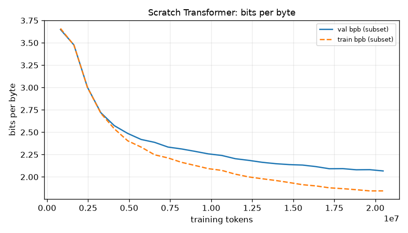

Hypothesis: a 1.87M-parameter byte-level Transformer beats the strongest count-based model on held-out plays, with non-overlapping 95% intervals.
Setup: lm-byte-small-2822813d-s0, 4 layers x 4 heads x 192, context 256, 2,500 steps x 8,192 tokens (20.5M tokens, ~4.5 epochs), AdamW lr 3e-3, warmup 100 + cosine, MPS, 291 s. Baselines: uniform, unigram, Kneser-Ney byte orders 2-7 and BPE-1024 orders 2-4, all fitted on train; best on validation was KN-4 on BPE-1024 tokens.
Observed: validation 2.086 bpb [2.074, 2.098] vs KN-4 2.107 [2.095, 2.120]. The point estimate is better by 0.021 bpb, but the intervals overlap by 0.003, so the pre-registered criterion is not met. Calibration is good for a small model: ECE 0.029, top-1 next-byte accuracy 57.0%. Train-subset bpb is 1.83 vs 2.09 on validation, so part of what it learned is specific to the training plays.
Test (opened once, logged): flagship 2.171 [2.158, 2.183] vs KN-4 2.191 [2.176, 2.206]; again a lower point estimate with slightly overlapping intervals. Test plays are harder than validation plays for every model.
Limitations: one seed; the model is undertrained (val loss was still falling at step 2,500); the KN baseline is a strong, well-tuned competitor at this data size.
Next test: the extended profile (10k steps, ~20 min, needs owner approval), which the capacity results suggest would separate the curves.
Decision: report as not supported. The same architecture at 4.85M parameters (lm-byte-medium) and with BPE tokens (lm-bpe1024-small) does beat the baseline with non-overlapping intervals on validation and test, which is evidence that capacity and context in bytes, not the architecture, limit the flagship.

## Byte vs BPE-1024 tokenization

**Verdict: supported.** BPE 2.007 vs byte 2.086 val bpb

- **Hypothesis.** At an equal optimizer-step and tokens-per-step budget, BPE-1024 reaches lower val bits-per-byte than byte-level, because each step covers more text.
- **Criterion (pre-registered).** BPE val bpb upper CI < byte val bpb lower CI.
- **Runs.** `lm-byte-small-2822813d-s0`, `lm-bpe1024-small-eb29b8fb-s0`
- **Caveats.** Not apples-to-apples in text seen: equal tokens per step means BPE sees ~3x more bytes. BPE adds (1024-256) x 192 embedding parameters; the comparison is per step, not per parameter. BPE merges are learned on the train split only.

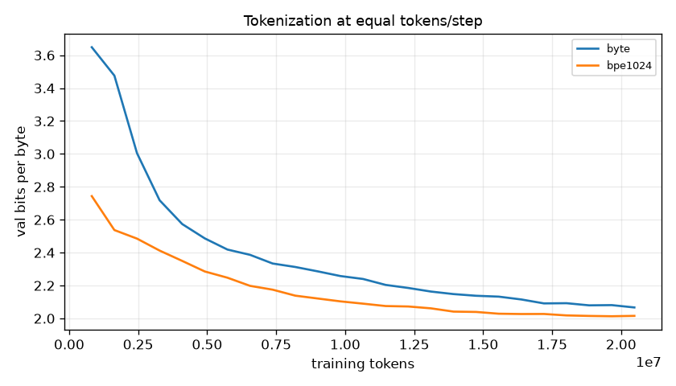

Hypothesis: at an equal step budget, BPE-1024 reaches lower val bits-per-byte than byte-level.
Setup: identical 4x4x192 model, 2,500 steps, 32 x 256 tokens per step. Only the tokenizer differs: BPE-1024 is byte-level BPE trained on the train split only.
Observed: BPE 2.007 [1.993, 2.021] vs byte 2.086 [2.074, 2.098] bpb on validation, non-overlapping, so supported. BPE averages 2.38 bytes per token, so in the same steps it saw ~48.7M bytes of text vs 20.5M, and a 256-token window covers ~610 bytes instead of 256. It also has 147K more embedding parameters (2.02M vs 1.87M). ECE is worse for BPE (0.055 vs 0.029). The test split agrees: 2.081 vs 2.171.
Limitations: not apples-to-apples in text seen, context in bytes, or parameters (stated before the run). This answers "per optimizer step at fixed token context", not "which tokenizer is better per byte of data".
Next test: equalise bytes seen (run the byte model ~2.4x longer) and context in bytes (byte block 608 vs BPE 256).
Decision: BPE is the better default at this compute. The byte model stays the flagship because its per-byte attention maps are interpretable in the UI.

## Model capacity at equal token budget (full data vs 240 KB scarce data)

**Verdict: supported.** full-data bpb tiny 2.335 / small 2.086 / medium 2.037; scarce medium val loss rose +1.257 nats after step 550

- **Hypothesis.** On the full 4.5 MB corpus, larger models reach lower val bpb at an equal token budget; on the 240 KB sample the medium model overfits (val loss rises after its minimum while train loss keeps falling).
- **Criterion (pre-registered).** Full data: bpb(medium) < bpb(small) < bpb(tiny). Scarce data: medium's final val loss exceeds its best val loss by > 0.05 nats while its train loss keeps decreasing.
- **Runs.** `lm-byte-tiny-840ad41c-s0`, `lm-byte-small-2822813d-s0`, `lm-byte-medium-b01e2a16-s0`, `scarce-byte-tiny-dcfe85f7-s0`, `scarce-byte-medium-d0cf6f70-s0`
- **Caveats.** Equal tokens, not equal FLOPs: the medium model spends ~4x the compute per token. One seed per arm.

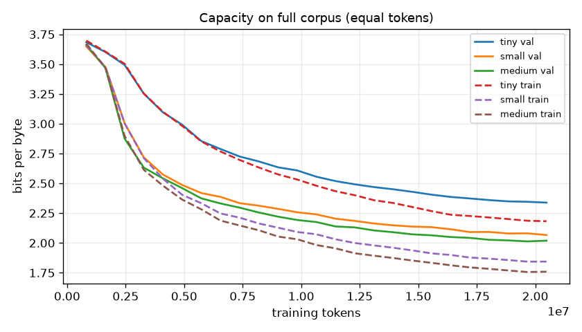
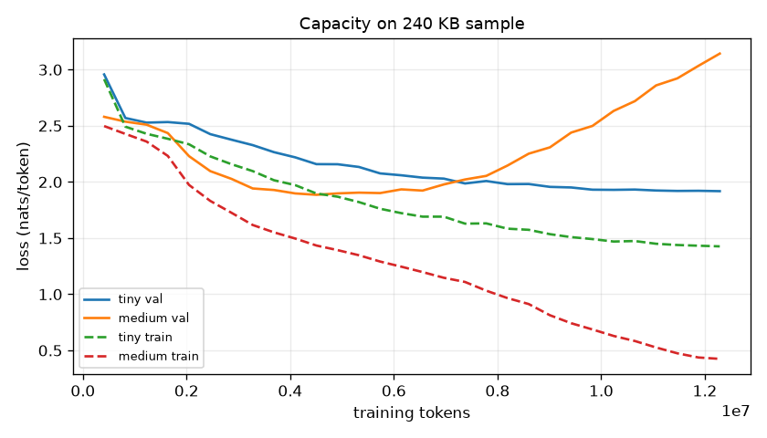

Hypothesis: on 4.5 MB, bigger models win at equal tokens; on 240 KB, the 4.85M-parameter model overfits.
Setup: tiny (0.27M) / small (1.87M) / medium (4.85M) byte models for 2,500 steps (20.5M tokens) on the full corpus; tiny and medium for 1,500 steps on the 240 KB sample (12.3M tokens, ~51 epochs).
Observed: full-data val bpb is 2.335 / 2.086 / 2.037, ordered as predicted, with non-overlapping intervals. On scarce data the medium model's best val loss was 1.886 nats at step 550, after which val loss climbed to 3.143 while train loss fell to 0.425: classic memorisation. Its best-checkpoint val bpb (2.756) is only slightly better than the tiny model's (2.771), which never overfit (final = best val loss, 1.918).
Limitations: equal tokens, not equal compute (medium spends ~2.5x the FLOPs per token of small: 33.4M vs 13.3M by the 6N + attention estimate); one seed each; the scarce validation set is the 40 KB sample of the same held-out plays.
Next test: equal-FLOPs sweep with 3 sizes x 2 seeds to fit a tiny scaling curve.
Decision: on scarce data, select the best validation checkpoint and use regularisation (see break-overfit); medium is the best byte model on full data.

## Learning rate and schedule, 3 seeds each

**Verdict: not supported.** opt-lr1e-3-cos: mean 3.1877 [3.1394, 3.2135]; opt-lr3e-3-cos: mean 2.6437 [2.6207, 2.6595]; opt-lr3e-3-const-nowarm: mean 2.6227 [2.5524, 2.6625]

- **Hypothesis.** For the tiny model at 1000 steps, lr 3e-3 with warmup+cosine beats lr 1e-3 cosine and beats lr 3e-3 constant without warmup, by more than the seed-to-seed range.
- **Criterion (pre-registered).** Mean val bpb ordered as hypothesised and the [min, max] ranges across seeds do not overlap.
- **Runs.** `opt-lr1e-3-cos-c19019e2-s0`, `opt-lr3e-3-cos-02b41a5f-s0`, `opt-lr3e-3-const-nowarm-9305a8d0-s0`, `opt-lr1e-3-cos-974d83cf-s1`, `opt-lr3e-3-cos-91a817f6-s1`, `opt-lr3e-3-const-nowarm-d4733739-s1`, `opt-lr1e-3-cos-2fd808a0-s2`, `opt-lr3e-3-cos-9ec26c43-s2`, `opt-lr3e-3-const-nowarm-5130eb0a-s2`
- **Caveats.** Three seeds give a range, not a confidence interval. Seeds change both initialisation and batch order.

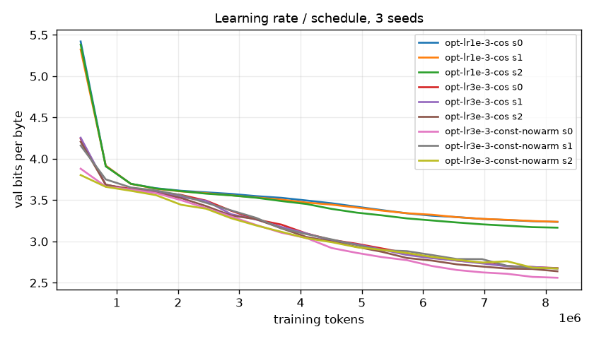

Hypothesis: for the tiny model at 1,000 steps, lr 3e-3 with warmup + cosine beats lr 1e-3 + cosine and beats lr 3e-3 constant without warmup, by more than the seed-to-seed range.
Setup: 3 configurations x seeds {0, 1, 2}; 1,000 steps x 8,192 tokens; seeds change both initialisation and batch order.
Observed: lr 1e-3 is clearly worse: mean 3.188 bpb [3.139, 3.213]. lr 3e-3 cosine has mean 2.644 [2.621, 2.660]; lr 3e-3 constant without warmup has mean 2.623 [2.552, 2.663]. The two lr 3e-3 schedules overlap, and the constant schedule's mean is slightly better. Its seed spread is 3x larger (stdev 0.061 vs 0.020) and its best seed (2.552) is an outlier. Not supported.
Interpretation (untested): in a short 1,000-step run, cosine decays the lr toward 3e-4, which may cost progress late in training; warmup did not matter for this model at 3e-3.
Limitations: 3 seeds give a range, not an interval; only one model size and one horizon.
Next test: same grid at 3,000 steps, plus lr 6e-3, to see whether the schedule ranking flips with a longer horizon.
Decision: keep warmup + cosine as the default for long runs (lower variance across seeds), and stop claiming it is better for short runs.

## Algorithmic transfer: digit-sum mod 10 under length shift

**Verdict: not supported.** digitsum-plain-s0: iid 0.111 near 0.097 far 0.094; digitsum-plain-s1: iid 0.111 near 0.106 far 0.107; digitsum-posaug-s0: iid 0.108 near 0.103 far 0.105; digitsum-posaug-s1: iid 0.111 near 0.103 far 0.106

- **Hypothesis.** A 2-layer model learns the rule in-distribution (3-6 terms, > 95% val accuracy) but fails to transfer to longer inputs (8-10 and 12-16 terms); random position offsets during training reduce but do not remove the gap.
- **Criterion (pre-registered).** Plain arm: val_iid acc > 0.95 and test_ood_far acc < 0.5. Pos-aug arm: OOD accuracy higher than plain arm for both seeds.
- **Runs.** `digitsum-plain-98e90485-s0`, `digitsum-posaug-45ea90a4-s0`, `digitsum-plain-4311223f-s1`, `digitsum-posaug-1551a6ac-s1`
- **Caveats.** Chance accuracy is 10%. Synthetic success is not evidence of general reasoning.

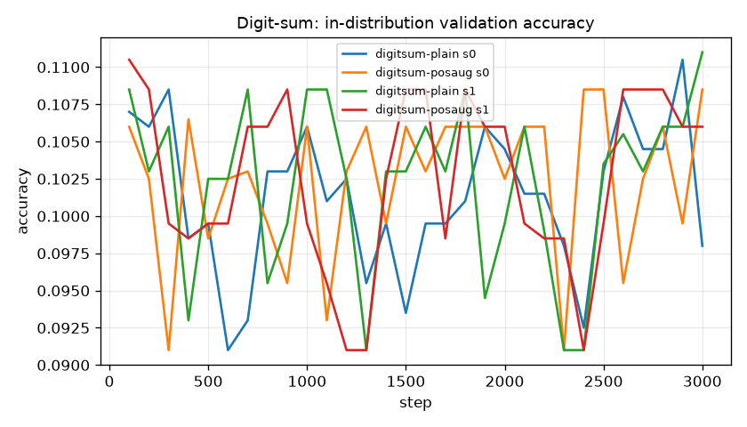

Hypothesis: a 2-layer model learns digit-sum mod 10 in-distribution (> 95% on 3-6 terms) but fails on 8-10 and 12-16 terms; position augmentation narrows the gap.
Setup: 2 layers x 4 heads x 128, block 48, batch 128, 3,000 steps, lr 1e-3; plain vs pos-aug arms, seeds 0 and 1. Loss only on the answer digit.
Observed: the model never learned the rule. Validation accuracy stayed at 10.8-11.1% (chance 10%) and the loss stayed at 2.303 nats = ln 10, i.e. a uniform guess over digits, for all four runs. The locked OOD splits are also at chance (9.4-10.7%). The in-distribution half of the hypothesis is not supported, so the length-shift question cannot be answered from these runs.
Diagnosis: (1) not a pipeline bug: tests/test_synthetic_learning.py::test_sumtask_pipeline_learns_a_copy_rule trains the same encoding, masking and evaluator on "answer = first digit" and reaches > 90% in 250 steps; (2) a sum mod 10 over 3-6 digits is parity-like: every digit matters equally, and gradient descent gets no partial credit until the whole aggregation exists, which is the known plateau behaviour of parity tasks.
Limitations: two seeds, one model size, 3,000 steps; a much longer run or curriculum might escape the plateau (grokking-style), and that was not tested.
Next test: digitsum-scratchpad (registered after this result): the same task with an interleaved running sum, so each step is local.
Decision: keep this negative result in the report, and test length generalisation with the scratchpad format.

## Algorithmic transfer, follow-up: running-sum scratchpad under length shift

**Verdict: supported.** digitsum-sp-plain-s0: iid 1.000 near 0.108 far 0.103; digitsum-sp-plain-s1: iid 1.000 near 0.105 far 0.098; digitsum-sp-posaug-s0: iid 1.000 near 0.346 far 0.105; digitsum-sp-posaug-s1: iid 1.000 near 0.985 far 0.887

- **Hypothesis.** Registered 2026-11-08 AFTER the plain digit-sum runs stayed at chance (loss = ln 10). With an interleaved running-sum scratchpad ('3,3;9,2;4,6;'), every step is local, so the 2-layer model learns the rule in-distribution (> 95% final-answer accuracy, autoregressive, on 3-6 terms). With learned absolute positions it still fails on longer inputs (12-16 terms < 50%) because those positions were never trained; random position offsets during training raise OOD accuracy for both seeds.
- **Criterion (pre-registered).** Plain-position arms: val_iid acc > 0.95 and test_ood_far acc < 0.5. Pos-aug arms: OOD near and far accuracy higher than the plain arm with the same seed.
- **Runs.** `digitsum-sp-plain-b231a0b3-s0`, `digitsum-sp-posaug-8fe76e50-s0`, `digitsum-sp-plain-43d26213-s1`, `digitsum-sp-posaug-65abe9b8-s1`
- **Caveats.** Follow-up designed after seeing a failure; the original digit-sum experiment is kept and reported. Evaluation is autoregressive: the model's own running sums are fed back; read-out restricted to digit tokens. Chance accuracy is 10%. Synthetic success is not evidence of general reasoning.

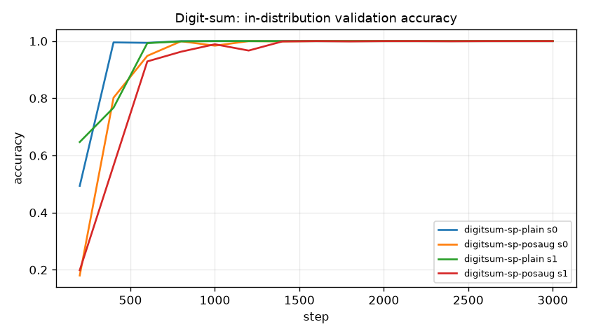

Hypothesis (registered after the plain digit-sum failure): with an interleaved running-sum scratchpad the 2-layer model learns the rule in-distribution (> 95%); with learned absolute positions it fails on 12-16 terms (< 50%); random position offsets raise OOD accuracy for both seeds.
Setup: "3,3;9,2;4,6;" format, block 72, 2 layers x 4 heads x 128, 3,000 steps, seeds 0/1 x {plain positions, position augmentation}. Evaluation is free-running: the model's own running sums are fed back, and only the digits are given. Selection used val_iid only; the OOD splits were opened once (test-access log).
Observed: all four runs reach 100.0% final-answer accuracy in distribution (3-6 terms). Plain positions: near-OOD (8-10 terms) 10.8% / 10.5% and far-OOD (12-16) 10.3% / 9.8% final-answer accuracy for seeds 0 / 1, i.e. chance. Per-step accuracy of ~70% (near) shows the model gets the early running sums right and fails once it reaches positions it never trained on. Position augmentation: seed 1 transfers almost perfectly (98.5% near, 88.8% far); seed 0 only partly (34.6% near, 10.5% far).
Verdict caveat: the analysis code marks this "supported" because both pos-aug seeds beat their plain twins on both OOD splits. For seed 0 on far-OOD the margin is +0.2 points (10.5% vs 10.3%, n = 2,000, standard error ~0.7 points), which is noise. The honest reading: position augmentation can fix length generalisation here, but whether it does depends strongly on the seed, and two seeds cannot estimate how often.
Limitations: two seeds; one model size; learned absolute positions only; a synthetic task, so this says nothing about general reasoning.
Next test: 5+ seeds per arm, and RoPE / no-position variants on the same splits.
Decision: report position-augmentation transfer as seed-dependent, never as a reliable fix; plain positions clearly do not extrapolate.

## Break the Model: learning rate far too high

**Verdict: supported.** broken: completed, best val bpb 4.078; warmup+clip at lr 0.1: 3.763; lr 3e-3: 3.422

- **Hypothesis.** lr=0.1 with no warmup and no clipping diverges or stalls far above the baseline; adding warmup and clipping alone does not rescue it; returning to lr=3e-3 does.
- **Criterion (pre-registered).** Broken arm: diverged or best val bpb > 3.0. Fix-1: reported as measured. Fix-2: best val bpb < broken arm's by > 0.5.
- **Runs.** `break-lr-broken-31ee17a1-s0`, `break-lr-fix1-warmup-clip-d5ba728d-s0`, `break-lr-fix2-lr3e-3-8991a8b4-s0`
- **Caveats.** Short runs (400 steps) by design.

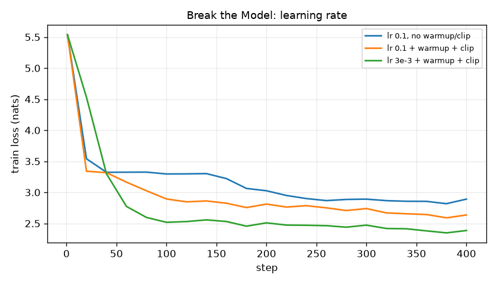

Hypothesis: lr 0.1 with no warmup and no clipping stalls or diverges; warmup + clipping alone do not rescue it; lr 3e-3 does.
Setup: tiny model, 400 steps, seed 0, three arms that differ only in lr / warmup / clipping.
Observed: it did not produce NaNs (grad norm max 1.75; AdamW normalises step size). Instead it stalled: best val 4.078 bpb, worse than a bigram. Warmup + clipping at lr 0.1 reached 3.763 bpb, better but still poor. lr 3e-3 with warmup + clipping reached 3.422 bpb. Supported (broken > 3.0, fix 2 is > 0.5 bpb better).
Limitations: one seed, 400 steps; the "no NaN" outcome depends on Adam. Plain SGD at this lr would likely diverge.
Next test: the same arms with SGD + momentum, to show actual divergence and the non-finite handler.
Decision: warmup and clipping stay on by default, and the lr comes from the optimization experiment. The trainer's non-finite handling is covered by test_divergence_is_detected_not_crashed.

## Break the Model: remove the causal mask

**Verdict: not supported.** train loss non-causal 2.441 vs causal 2.386; leak-free bpb 3.593 vs 3.571

- **Hypothesis.** Without the mask the training loss collapses (the model reads the answer from the future), but on leak-free last-position scoring it is far worse than the causal model.
- **Criterion (pre-registered).** Non-causal train loss < causal train loss AND non-causal leak-free bpb > causal leak-free bpb.
- **Runs.** `break-mask-noncausal-5422370f-s0`, `break-mask-causal-25bac1ba-s0`
- **Caveats.** The usual windowed val metric is itself leaky for a non-causal model; analysis uses last-position-only scoring, which cannot see the future for either model.

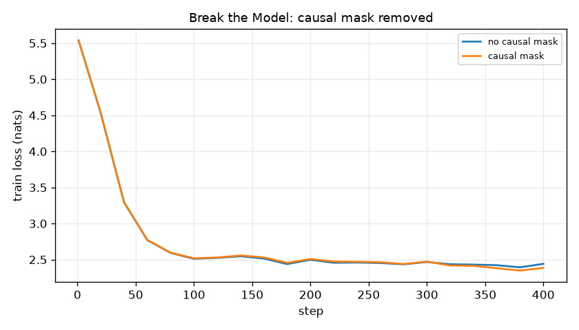

Hypothesis: without the causal mask, training loss collapses (the model reads the next token from the future), while honest last-position scoring is worse than the causal model's.
Setup: tiny model, 400 steps, seed 0; identical except causal=False. Leak-free scoring uses only the final position of 2,048 random windows, where no model can see the future.
Observed: the predicted collapse did not happen within 400 steps. The non-causal model's final train loss was 2.441 vs 2.386 for the causal model, and its leak-free bpb was 3.593 vs 3.571. The non-causal model is slightly worse everywhere, but it had not yet learned to attend one position ahead. Not supported as stated.
Why: with learned absolute positions, the shortcut needs a query/key pattern that targets position t+1 for every t. At this size and lr, 400 steps are not enough to find it.
Limitations: one seed, a short horizon by design.
Next test: the same pair for 2,000 steps (break-mask-long), registered after this result and disclosed as a follow-up.
Decision: the unit test test_non_causal_model_fails_leakage_check is the guard that catches a missing mask immediately, independent of training dynamics.

## Break the Model, follow-up: no causal mask for 2,000 steps

**Verdict: supported.** train loss non-causal 0.010 vs causal 1.564; leak-free bpb 3.379 vs 2.571

- **Hypothesis.** Registered 2026-11-08 AFTER break-mask (400 steps) showed no collapse. Given 5x more steps, the mask-less model finds the copy-from-the-future shortcut: its training loss falls well below the causal model's, while leak-free last-position bpb is worse than the causal model's.
- **Criterion (pre-registered).** Non-causal train loss < causal train loss AND non-causal leak-free bpb > causal leak-free bpb.
- **Runs.** `break-mask-long-noncausal-09c37c67-s0`, `break-mask-long-causal-388930e3-s0`
- **Caveats.** Follow-up designed after seeing break-mask; that result is kept and reported. Leak-free scoring uses only the final position of each window.

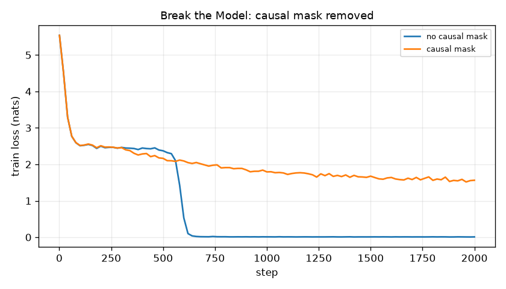

Hypothesis (registered after break-mask showed no collapse at 400 steps): given 2,000 steps, the mask-less model finds the copy-from-the-future shortcut; its training loss falls far below the causal model's, while leak-free bpb is worse.
Setup: tiny model, 2,000 steps, seed 0; arms identical except causal=False. Leak-free scoring: the final position of 2,048 random validation windows (no future tokens exist there for any model).
Observed: the shortcut appeared between steps 600 and 700. The non-causal model's final train loss was 0.010 nats against 1.564 for the causal model. Its windowed validation bpb, computed with the same leak, is 0.0135, a "perfect" score that is pure leakage. Leak-free scoring gives 3.379 bpb for the non-causal model against 2.571 for the causal one. Supported.
Lesson: a metric computed with the same leak as training looks almost perfect; only an evaluation that structurally cannot see the future reveals the failure.
Limitations: one seed; the windowed metric shown for the non-causal arm is deliberately the leaky one.
Decision: keep the mask, keep the leakage unit test as the guard, and evaluate any non-causal variant only with leak-free scoring.

## Break the Model: memorising a 240 KB corpus, then a regularisation fix

**Verdict: supported.** best val loss 1.886 -> 1.841; fix status early_stopped at step 1200

- **Hypothesis.** Medium model on the scarce sample overfits; dropout 0.2 + early stopping (patience 4) gives a lower best val loss and stops before the overfit regime.
- **Criterion (pre-registered).** Fix arm best val loss < broken arm best val loss, and fix arm stops early.
- **Runs.** `scarce-byte-medium-d0cf6f70-s0`, `scarce-byte-medium-dropout-es-1ec37376-s0`
- **Caveats.** The broken arm is shared with the capacity experiment (same config hash).

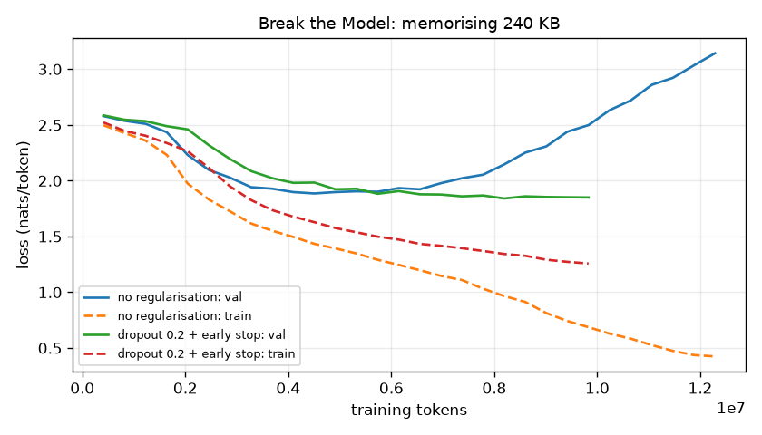

Hypothesis: the 4.85M-parameter model memorises the 240 KB sample; dropout 0.2 + early stopping (patience 4 evals) gives a lower best val loss and stops before the overfit regime.
Setup: scarce-byte-medium (no regularisation, 1,500 steps) vs scarce-byte-medium-dropout-es (dropout 0.2, early stopping), same seed and data.
Observed: without regularisation, the best val loss was 1.886 at step 550 and the final val loss 3.143. With the fix, the best val loss was 1.841 and training stopped itself at step 1,200 (status early_stopped). Supported.
Limitations: the improvement in best val loss is modest (0.045 nats). Most of the benefit is not wasting compute in the overfit regime and not shipping the last checkpoint. One seed.
Next test: a dropout sweep {0.1, 0.2, 0.3} x 2 seeds, plus weight decay 0.3.
Decision: always report the best-on-validation checkpoint (the trainer already does), and enable early stopping for scarce-data runs.

## Scratch Transformer vs count-based baselines (extended profile)

**Verdict: supported.** Transformer 1.993 bpb vs best n-gram (kneser-ney-4, bpe1024) 2.107

- **Hypothesis.** A 1.9M-parameter byte-level Transformer trained from scratch reaches lower held-out bits-per-byte than the best interpolated Kneser-Ney n-gram (order chosen on validation).
- **Criterion (pre-registered).** Transformer val bpb upper 95% CI < best n-gram val bpb lower 95% CI.
- **Runs.** `lm-byte-small-240f8c28-s0`
- **Caveats.** Single seed for the flagship run (seed variation is measured in the optimization experiment). Validation plays are other Shakespeare plays: same author and era, so this is in-domain.

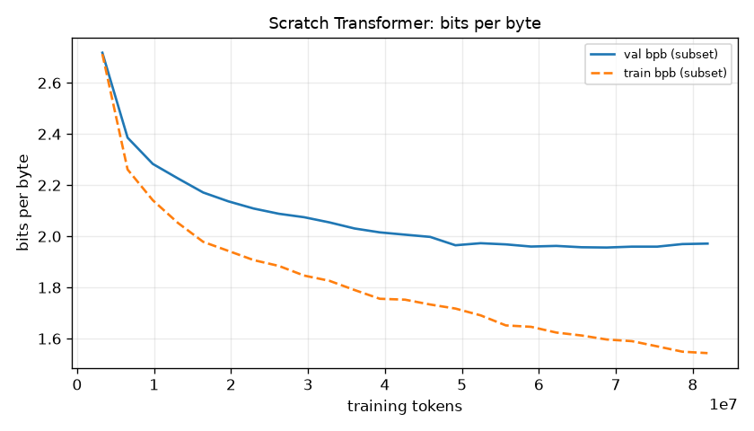

Hypothesis: the pre-registered scratch hypothesis, unchanged. The same 1.87M-parameter byte-level recipe beats the best n-gram with non-overlapping 95% intervals. Only the step budget differs: the extended profile, which the owner approved on 2026-11-08 after seeing the measured estimate (16 min, 765 MB, 43 MB of checkpoints).
Setup: lm-byte-small-240f8c28-s0, 10,000 steps x 8,192 tokens = 81.9M tokens (~18 epochs), lr 3e-3, warmup 100 + cosine, MPS, 924 s, clean commit 667bb5f.
Observed: validation 1.993 bpb [1.981, 2.006] vs KN-4 2.107 [2.095, 2.120]. Supported, with a 0.09 bpb gap between the intervals. The best validation checkpoint was step 8,400. Train-subset bpb is 1.569 against 1.993 on validation, so the generalisation gap widened from 0.25 (standard run) to 0.42 bpb: with ~18 passes over 4.5 MB the model is starting to memorise. ECE 0.043 (standard: 0.029); top-1 next-byte accuracy 60.0%.
Test (third logged opening, after selection): 2.089 [2.075, 2.103] vs KN-4 2.191 [2.176, 2.206], separated there too.
Reading: the standard-profile "not supported" was a budget limit, not an architecture limit. Both results stay in the report: the standard verdict is unchanged, and this is a separate finding at a separate budget.
Limitations: one seed; more steps means more epochs over the same small corpus, so gains will flatten and overfitting grow (best step 8,400 of 10,000).
Next test: add dropout 0.1 at this budget, or more data (other public-domain Elizabethan drama), rather than more steps.
Decision: the extended run is the reference byte-level model (export with `morrowglass export-artifact lm-byte-small-240f8c28-s0`).

## Pretrained adaptation: distilgpt2 + LoRA vs frozen

**Verdict: supported.** frozen 1.941 [1.927, 1.955] -> LoRA 1.760 [1.748, 1.773] val bpb; 147,456 of 82,060,032 params trained

- **Hypothesis.** Written 2026-11-08 while the approved run was in progress, before any result was seen: LoRA adapters (r=8, alpha 16, on the attention c_attn projections; 300 steps x 8 x 256 GPT-2 tokens, lr 2e-4) lower distilgpt2's bits-per-byte on the held-out Shakespeare validation plays relative to the frozen model.
- **Criterion (pre-registered).** LoRA val bpb upper 95% CI < frozen val bpb lower 95% CI (full validation split).
- **Runs.** `reports/lora/distilgpt2-s0.json`
- **Caveats.** distilgpt2 was pretrained on OpenWebText, which may contain Shakespeare: weaker held-out guarantee. GPT-2 tokenizer and 256-token context (~4x the bytes of the byte models' context). One seed; validation only; the locked test split is untouched.

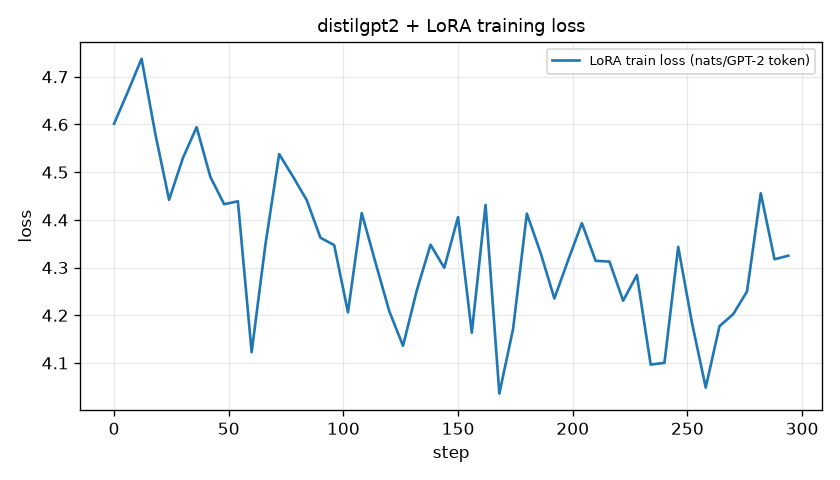

Hypothesis (written while the approved run was in progress, before results): LoRA adapters lower distilgpt2's validation bits-per-byte relative to the frozen model, with non-overlapping 95% intervals.
Setup: distilgpt2 (82.06M params, downloaded from the Hugging Face Hub with the owner's approval on 2026-11-08). LoRA r=8, alpha 16, dropout 0.05 on the attention c_attn projections: 147,456 trainable params (0.18%). 300 steps x 8 x 256 GPT-2 tokens = 614K tokens (0.44 of an epoch over the 1.39M-token train split), lr 2e-4, seed 0, MPS. Evaluation: the full validation split (425,672 bytes, 509 windows of 256 GPT-2 tokens, context reset per window), using exact GPT-2 byte lengths (asserted to reconstruct the text).
Observed: frozen 1.941 bpb [1.927, 1.955], LoRA 1.760 [1.748, 1.773], a drop of 0.181 bpb with clearly separated intervals. Supported. Training took 106 s, plus 40 s to load the model.
Context: even frozen, distilgpt2 beats every model trained from scratch here (best 2.007 for BPE-1024-small on validation). That reflects ~41x more parameters and pretraining on far more text, not a better recipe for 4.5 MB of data.
Limitations: distilgpt2's pretraining corpus (OpenWebText) may contain Shakespeare, so "held-out" is weaker than for the scratch models; the GPT-2 context covers ~4x more bytes; one seed; validation only (the locked test split was not opened for this run).
Provenance note: the run recorded git dirty=true because analysis/report modules were being edited while it ran; src/morrowglass/finetune/lora.py was identical to commit 39112b3 (checked with git diff).
Next test: full fine-tuning vs LoRA at matched steps, and r in {2, 8, 32}, on the same split.
Decision: the pretrained + LoRA track is the strongest model in this repo; the scratch track remains the instrument for studying the internals.

